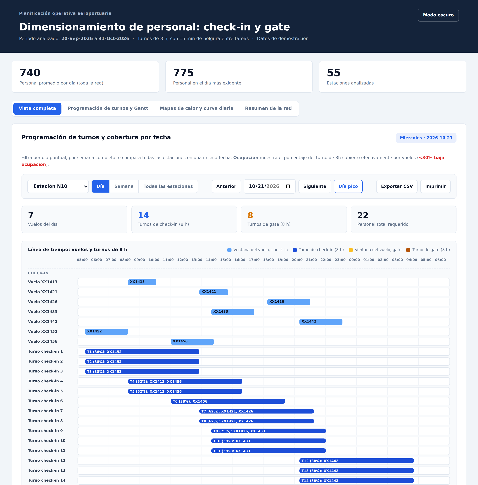

# Dimensionamiento de Personal — Check-in & Gate

Herramienta de escritorio (Python + Tkinter) que calcula el **mínimo de personal
necesario por día y por estación** para los servicios de **check-in** y **gate**,
a partir de una malla de itinerario de vuelos en Excel.

El resultado se entrega en dos formatos:

1. `personal_requerido.xlsx` — detalle diario tabular por estación.
2. `dashboard_dimensionamiento.html` — dashboard interactivo de un solo archivo
   que se abre con doble clic en cualquier navegador (mapas de calor, Gantt,
   programación de turnos, exportación a CSV e impresión).



*Dashboard generado con una red ficticia de 55 estaciones.*

## Contexto de uso

Esta herramienta nació de una necesidad real en una operación aeroportuaria. La planificación de turnos de check-in y gate se hacía a partir de la malla de itinerario en Excel, calculando a mano cuánto personal necesitaba cada estación cada día, un proceso que podía tomar varias semanas.

La herramienta automatiza ese cálculo. Se ha probado con los itinerarios de septiembre y octubre sobre una red de 55 estaciones, y el resultado se genera en pocos segundos. Quien la usa no tiene perfil técnico, por eso se distribuye como un ejecutable de Windows que no requiere instalar Python ni ninguna dependencia: se arrastra el Excel y se obtiene el resultado en una carpeta "Resultados".

Los datos de la operación real no se incluyen en este repositorio. Las imágenes y ejemplos usan itinerarios ficticios.

## ¿Cómo funciona?

1. Se carga la malla de itinerario (`.xlsx` / `.xls`) con las columnas:
   `EFFECTIVE FROM`, `EFFECTIVE TO`, `DOW`, `ETD`, `DEPARTURESTATION`,
   `ARRIVALSTATION`, `FLIGHTNUMBER`.
2. Cada vuelo se clasifica como **nacional** o **internacional** según sus
   estaciones de origen/destino.
3. A cada servicio se le asignan ventanas de tiempo antes de la salida
   (check-in y gate) con una cantidad de personas por vuelo.
4. Se calculan los turnos de 8 horas necesarios (con un buffer de 15 minutos
   por cambio de sala) para cubrir toda la demanda del día.
5. Se generan el Excel de resultados y el dashboard HTML.

## Reglas configurables

Los parámetros del modelo están al inicio de `CalculadoraPersonal.py` y se
pueden ajustar sin tocar la lógica de cálculo:

| Parámetro | Descripción |
| --- | --- |
| `DURACION_TURNO` | Duración total del turno (la hora de comida va incluida). |
| `BUFFER_CAMBIO_SALA` | Tiempo de holgura entre tareas de una misma persona. |
| `REGLAS` | Duración y personas por servicio, según tipo de vuelo. |
| `ESTACIONES_NACIONALES` | Códigos IATA que definen la regla "nacional". |

## Uso para el usuario final

El usuario final **no necesita instalar nada**: solo abre
`dist/CalculadoraPersonal/CalculadoraPersonal.exe`, arrastra el Excel de la
malla sobre la ventana (o usa el botón) y el programa genera una carpeta
`Resultados` junto al archivo seleccionado.

> Nota: hay que compartir la **carpeta completa** generada (no solo el `.exe`
> suelto), normalmente comprimida en un `.zip`.

## Compilar el ejecutable

Ejecutar una sola vez, en un equipo que tenga Python instalado:

```bat
1_generar_exe.bat
```

El script instala las dependencias y ejecuta PyInstaller en modo `--onedir`
(la ventana aparece de inmediato en cada arranque). El resultado queda en
`dist\CalculadoraPersonal\`.

### Ejecución directa desde el código fuente

```bash
pip install pandas numpy openpyxl plotly tkinterdnd2
python CalculadoraPersonal.py
```

## Tecnologías

- Python 3 + Tkinter (interfaz)
- `pandas` / `numpy` (cálculo)
- `openpyxl` (lectura/escritura de Excel)
- `plotly` (gráficas del dashboard)
- `tkinterdnd2` (arrastrar y soltar, opcional)
- PyInstaller (empaquetado)

## Estructura del repositorio

```
CalculadoraPersonal.py    Código fuente único (toda la lógica y la interfaz).
1_generar_exe.bat         Script que genera el ejecutable.
README.md                 Este archivo.
```

## Notas

- `CalculadoraPersonal.py` es el **único archivo fuente**: si hay que ajustar
  una regla, se edita solo ahí para evitar versiones desincronizadas.
- Los artefactos de compilación (`build/`, `dist/`, `.spec`, `.exe`, `.rar`) y
  los archivos de datos (`*.xlsx`, `*.csv`) están excluidos del control de
  versiones mediante `.gitignore`.

## Licencia

Copyright (c) 2026 Kevyn Sena. Todos los derechos reservados. El código se publica para consulta; para cualquier otro uso, escríbeme.
